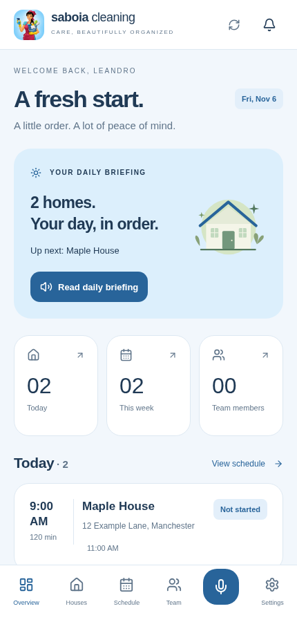
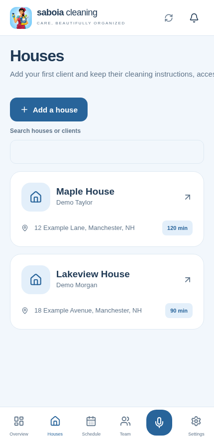
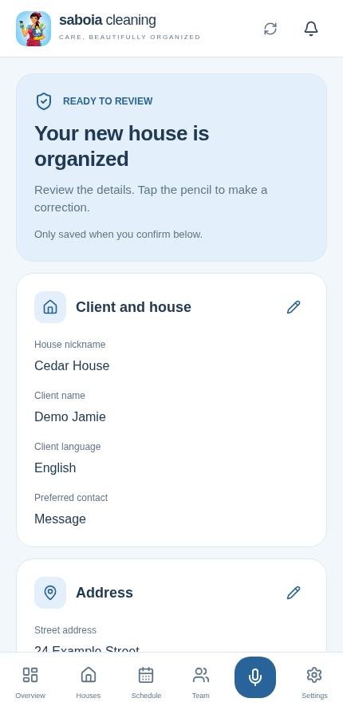

<div align="center">
  
  <h1>Saboia Cleaning</h1>
  <p><strong>A bilingual mobile workspace for a real cleaning business.</strong></p>
  <p>Plan the day. Find each home's instructions. Review AI suggestions. Finish with confidence.</p>
  <p>
    <a href="https://github.com/leandrosaboia777-star/projeto-1/actions/workflows/ci.yml"></a>
    
    
    
    
    
  </p>
  <p><a href="#see-it-in-action">Demo</a> · <a href="#what-the-app-does">Features</a> · <a href="docs/CASE-STUDY.md">Case study</a> · <a href="docs/DEVELOPMENT.md">Run locally</a> · <a href="docs/SECURITY.md">Security</a></p>
</div>

## Built around a real workflow

Saboia Cleaning grew from a practical need in a family-run cleaning business: keep house instructions, recurring appointments, client changes, and day-to-day work in one place.

The product evolved through direct owner feedback and testing of internally distributed iPhone builds. A request such as “add this house every Tuesday at 9” becomes an editable review, with an explicit confirmation before any business record changes.

**Current stage:** active development and private iPhone testing, with owner-reported installation and use of core workflows. Distribution currently uses internal builds. See the [delivery status](docs/STATUS.md) for verified behavior and remaining release work.

## See it in action

<p align="center"><a href="docs/demo/saboia-cleaning-demo.mp4"></a></p>

**[Watch or download the English walkthrough →](docs/demo/saboia-cleaning-demo.mp4)**

The recording shows the actual interface in a phone-sized browser viewport, using synthetic customer data and fixture-backed APIs, including the AI proposal. It covers planning, house profiles, editable review, explicit confirmation, and dark appearance.

<table>
  <tr>
    <td align="center"><strong>Plan the day</strong><br/></td>
    <td align="center"><strong>Find each home</strong><br/></td>
    <td align="center"><strong>Review before saving</strong><br/></td>
  </tr>
</table>

More screens: [Schedule](docs/portfolio/schedule.png) · [Dark appearance and settings](docs/portfolio/settings-dark.png)

## What the app does

| Area | Practical capability |
| --- | --- |
| **Client and house profiles** | Contact details, addresses, cleaning instructions, checklists, products, pets, parking, and estimated duration. |
| **House covers and photo records** | A recognizable cover photo in the house list, separate occurrence records with captions, and private image access. |
| **Recurring schedules** | One-time, weekly, biweekly, monthly, and custom-week appointments; changes to one visit, future visits, or a series. |
| **Work tracking** | Start a cleaning, check off tasks, record notes, and explicitly mark it complete. Estimated time does not complete the job automatically. |
| **Voice and text assistant** | Turn natural-language requests into readable, editable proposals. Database writes require confirmation. |
| **Client rescheduling** | Import a message, review available-window suggestions, choose a time, and confirm. SMS replies open as drafts for the user to send. |
| **Team access** | Manager and employee permissions, employee invitations, and assignment-based access. |
| **English and Portuguese** | Localized UI and optional AI translation of saved descriptive text, while preserving original records and identity/address fields. |
| **Briefings and reminders** | Read or listen to a schedule summary; configure device reminders and optional server-side pending-request alerts. |
| **Daily encouragement** | Embedded bilingual Scripture excerpts and separate reflections, with morning and completed-workday messages and optional local notifications. |

The app does not read the iMessage/SMS inbox automatically. Availability suggestions use the saved schedule and a conservative time window; they do not calculate driving routes or interpret free-text staff availability as guaranteed capacity.

## Technical decisions worth reviewing

| Decision | Why it matters | Where to look |
| --- | --- | --- |
| Business-scoped database policies | Enforce account and assignment boundaries beyond the interface. | [Migrations](supabase/migrations), [security notes](docs/SECURITY.md) |
| Timezone-aware recurrence | Preserve business wall-clock times across daylight-saving changes. | [Scheduling domain](src/domain/schedule.ts), [domain tests](tests/domain.test.ts) |
| Explicit AI confirmation | Keep probabilistic interpretation separate from authorized transactional writes. | [Proposal review](src/components/ProposalReview.tsx), [confirmation function](supabase/functions/confirm-proposal) |
| Protected access instructions | Encrypt door/alarm information separately from ordinary house notes. | [Private-access function](supabase/functions/private-access), [encryption implementation](supabase/functions/_shared/encryption.ts) |
| Private photo delivery | Use access policies and expiring signed URLs for covers and records. | [Photo component](src/components/PrivatePhoto.tsx), [cover migration](supabase/migrations/202611060007_house_cover.sql) |
| Native iOS text sharing | Bridge explicitly shared text through an App Group and Share Extension. | [Share Extension](targets/share), [iOS notes](docs/IOS.md) |
| Reproducible updates | Check download hashes and preserve local signing/environment settings. | [Update helper](scripts/update-devotions.cjs), [updater tests](tests/requests-updater.test.cjs) |

## Stack

**Mobile/UI:** React Native, Expo SDK 58, React, TypeScript, React Native Web, Lucide icons.

**Backend:** Supabase Auth, PostgreSQL, Row Level Security, private Storage, and Deno Edge Functions.

**AI and device features:** server-side OpenAI API integration, speech recognition/synthesis, local notifications, optional Expo push delivery, and an iOS Share Extension.

**Validation:** Node test runner, TypeScript checks, Deno checks/tests, PostgreSQL integration tests, Playwright browser workflows, and Expo bundle/prebuild checks.

## Project ownership and AI collaboration

**Leandro Saboia — product owner and project lead**

I defined the real-world requirements, gathered feedback from the business user, guided interface and workflow decisions, configured the connected services, and tested installed iPhone builds through repeated iterations.

The implementation, debugging, test scaffolding, visual asset adaptation, and documentation were developed with substantial assistance from OpenAI's coding and image-generation tools. My role centered on product direction, acceptance testing, integration setup, and evaluating the results against the business workflow.

This repository documents that collaboration and its engineering decisions. Read the [case study](docs/CASE-STUDY.md) for the problem, iteration process, trade-offs, and next steps.

## Explore or evaluate locally

```sh
git clone https://github.com/leandrosaboia777-star/projeto-1.git
cd projeto-1
npm ci
cp .env.example .env
# Set your own public Supabase URL and anon/publishable key.
npm start
```

The repository contains the original owner's Expo/Apple project identifiers. A separate native deployment requires adapting those identifiers and configuring your own services. Never put AI, encryption, or service-role secrets into public frontend variables.

See [development and deployment](docs/DEVELOPMENT.md) for backend migrations, server secrets, local testing, and signed iPhone build instructions. Local evaluation is covered by the limited permission in [LICENSE.md](LICENSE.md).

## Verification and limits

The repository contains tests for recurrence and DST, schema validation, tenant/role boundaries, scheduling conflicts, atomic confirmation, encryption, photo-cover permissions, notification planning, and browser workflows.

Browser fixtures and mocked notification APIs test wiring and rules. They do not establish live provider accuracy or real iOS notification delivery. An iOS JavaScript export is a bundle check, not a signed native compilation. Current evidence and unresolved release work are tracked in [STATUS.md](docs/STATUS.md).

Next steps include release/privacy hardening, account deletion/export UX, live translation quality checks, notification delivery verification, and travel-aware scheduling. Business impact metrics will be evaluated through future use.

## Documentation

- [Product case study](docs/CASE-STUDY.md)
- [Development and deployment](docs/DEVELOPMENT.md)
- [Security and recovery](docs/SECURITY.md)
- [Current delivery status](docs/STATUS.md)
- [iPhone installation and build automation](docs/IPHONE.md)
- [Client requests and reminders](docs/REQUESTS.md)
- [House covers, translation, and branding](docs/HOME-UPDATE.md)
- [Daily Scripture and reflections](docs/DEVOTIONS.md)
- [Reproducing the portfolio media](docs/portfolio/README.md)

## Rights and contact

**Proprietary source — all rights reserved, with limited noncommercial evaluation permission.** You can review and evaluate the project as a portfolio. Commercial reuse, redistribution, or derivative-product use requires the owner’s permission. Third-party dependencies retain their own licenses. See [LICENSE.md](LICENSE.md).

**Project owner:** [Leandro Saboia](https://github.com/leandrosaboia777-star)

For professional inquiries, see the public contact links on my GitHub profile. For a reproducible technical issue, use this repository's Issues section.
